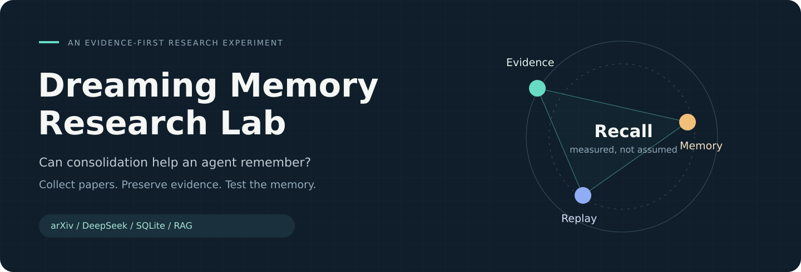
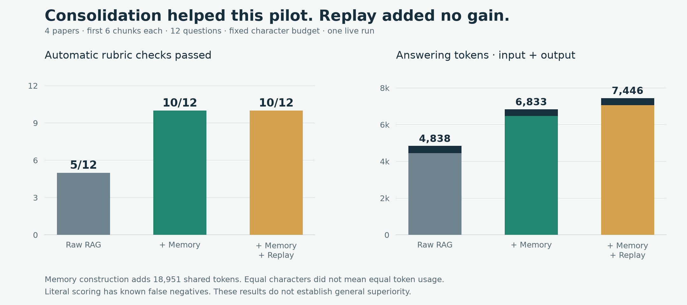
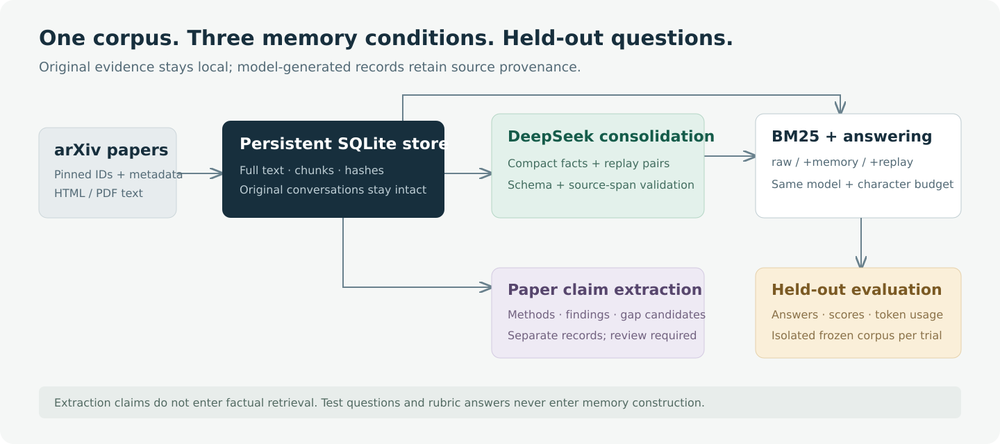

<p align="center">
  
</p>

<p align="center">
  <a href="https://github.com/dakshdoesdev/ai-dreaming-memory/actions/workflows/tests.yml"></a>
  <a href="docs/GETTING_STARTED.md"></a>
  <a href="LICENSE"></a>
</p>

# Dreaming Memory Research Lab

**Can an agent remember research better by compressing and replaying its experiences?**

This Python experiment collects arXiv papers, extracts evidence-grounded research claims with **DeepSeek through AMD Token Lab**, and compares persistent memory against ordinary lexical RAG. It preserves original evidence and measures the tradeoffs instead of assuming that more memory helps.

[Quick start](#quick-start) · [Results](artifacts/RESULTS.md) · [CLI reference](docs/CLI.md) · [Architecture](docs/ARCHITECTURE.md) · [Contributing](CONTRIBUTING.md)

## The first experiment



| Retrieval condition | Rubric checks passed | What it reads |
| --- | ---: | --- |
| Raw RAG | **5 / 12** | Original paper chunks |
| RAG + compressed memory | **10 / 12** | Originals and compact facts |
| RAG + memory + replay | **10 / 12** | Originals, compact facts and synthetic Q&A |

**Consolidation helped this pilot; replay added no gain.** This was one run on the first six chunks of four papers, with a fixed character budget. Literal scoring has documented false negatives, and the memory arms used more tokens. These results do not establish general superiority over RAG.

Read the [full results, costs and scoring audit](artifacts/RESULTS.md), or inspect the [raw answers and provenance hashes](artifacts/deepseek-pilot.json).

## What the agent does

- **Collect:** pin arXiv versions and store full text, metadata and content hashes locally.
- **Extract:** identify candidate methods, findings and author-reported gaps with source evidence.
- **Remember:** keep compact memories and generated replay pairs in SQLite alongside original evidence.
- **Compare:** evaluate three retrieval conditions against the same held-out questions.
- **Inspect:** export answers, metrics and provenance hashes without distributing downloaded papers.

The initial collection contains **four full papers and 333 chunks**. The prefix extraction produced **97 candidate claims**; a textual audit flagged four invalid gap classifications. Source grounding verifies where text came from, not whether an interpretation is scientifically correct. See the [extraction audit](artifacts/EXTRACTION_AUDIT.md).

## Quick start

You need **Python 3.11+ with SQLite FTS5**. There are no external Python packages to install for the application or its unit tests. Poppler's `pdftotext` is needed only when a paper has no usable HTML.

```bash
git clone https://github.com/dakshdoesdev/ai-dreaming-memory.git
cd ai-dreaming-memory

# No key or network needed for these checks.
python3 -m unittest discover -v
python3 memory_lab.py --offline evaluate --out results/first-smoke.json
```

The offline model always answers `UNKNOWN`; its scores verify the workflow, not memory capability. Use a new report filename each time.

To collect papers and run the real model:

```bash
python3 research_lab.py collect

# Enter your AMD Token Lab key without placing it in shell history.
read -rsp 'AMD Token Lab key: ' OPENAI_API_KEY; echo
export OPENAI_API_KEY
export OPENAI_BASE_URL=https://api.tokenlab.amd.com/v1
export TOKEN_LAB_MODEL=DeepSeek-V4-Flash

# Explicitly limited to the first six chunks of each paper.
python3 research_lab.py extract --max-chunks-per-paper 6 > data/first-extraction.json
python3 research_lab.py evaluate --max-chunks-per-paper 6 --out results/first-pilot.json
```

Model calls send selected text to AMD Token Lab and consume your account's points. The callable model ID above was verified during the pilot; catalog display names and future model availability can differ. The application does not load `.env` files.

Continue with the [getting-started walkthrough](docs/GETTING_STARTED.md) for persistent questions, report export and failure recovery. All commands and defaults are in the [CLI reference](docs/CLI.md).

## How memory flows



Consolidation creates compact facts and synthetic recall pairs in batches. JSON schemas restrict source identifiers; Python reconstructs evidence spans from the original text and validates them before saving. Original text is retained. Extracted paper claims are stored separately and are not automatically promoted into factual retrieval.

Evaluation uses isolated temporary databases, consolidates after each six ingested chunks, and keeps questions and expected answers out of memory construction. Every arm uses the same answering model, prompt, retrieval count and character budget. There is no background service or model fine-tuning.

See [architecture and storage](docs/ARCHITECTURE.md) and the [experiment protocol](docs/EXPERIMENT.md).

## Documentation

| You want to… | Start here |
| --- | --- |
| Run a first experiment | [Getting started](docs/GETTING_STARTED.md) |
| Look up a flag, default or recovery step | [CLI reference](docs/CLI.md) |
| Understand modules, storage and provenance | [Architecture](docs/ARCHITECTURE.md) |
| Review the research design | [Protocol](docs/EXPERIMENT.md) and [source research](docs/RESEARCH.md) |
| Inspect results and extraction errors | [Live results](artifacts/RESULTS.md) and [extraction audit](artifacts/EXTRACTION_AUDIT.md) |
| Improve the project | [Contributing](CONTRIBUTING.md) and [changelog](CHANGELOG.md) |

The original conversation agent is also available through `python3 memory_lab.py chat`. It persists conversations, consolidates every six user messages, and supports `/dream` and `/quit`. Assistant replies are saved as transcript history but excluded from factual evidence.

## Scope and limitations

- This is a **custom paper-QA pilot**, not an official MemoryAgentBench run or a demonstration of autonomous scientific discovery.
- Task completion means satisfying text constraints. Comparison rubrics cannot establish expert-level attribution or citation accuracy.
- The prefix study does not analyze full papers. Public papers may already be in model pretraining.
- Equal characters are not equal tokens. Shared memory/replay construction adds cost; replay did not improve this run's accuracy.
- A source-valid quotation can still support an incorrect interpretation. Candidate gap labels require review.
- SQLite storage is local plaintext. Keep downloaded papers, databases, keys and private run logs out of Git. Public exports retain model answers, so inspect them before sharing.

The project uses a BM25 baseline; larger independent paper sets, expert-audited scoring and dense/hybrid baselines are still needed. [All recorded limitations](artifacts/RESULTS.md).

## Research and license

Built around questions raised by [MemoryAgentBench](https://github.com/HUST-AI-HYZ/MemoryAgentBench), [LongMemEval](https://github.com/xiaowu0162/LongMemEval), [MemGPT](https://arxiv.org/abs/2310.08560v2) and [CoALA](https://arxiv.org/abs/2309.02427v3). Exact paper versions are in the [corpus manifest](artifacts/corpus-manifest.json).

Original code and documentation are [MIT licensed](LICENSE). Third-party papers and datasets retain their own licenses.
