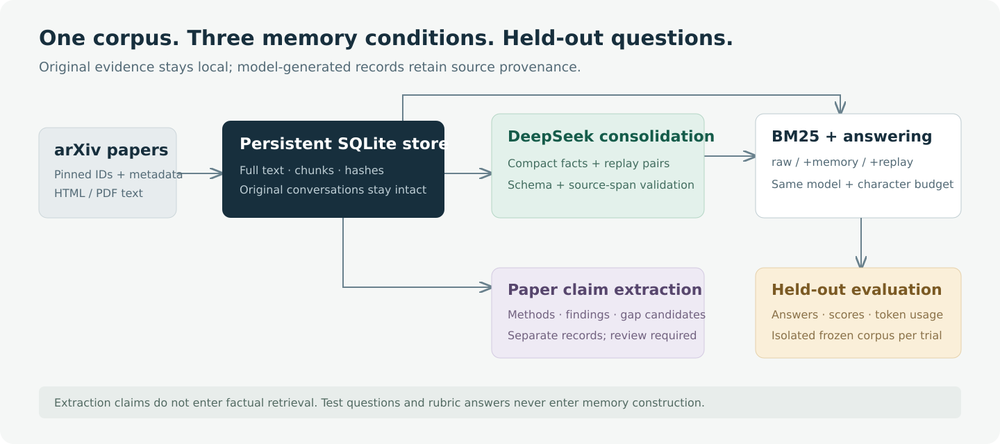

# Architecture

Dreaming Memory Research Lab is a local Python CLI, not a hosted service. Its persistent state is SQLite plus an arXiv download cache. The only remote systems are arXiv for collection and the configured compatible chat endpoint for model inference.

## Two paths through the same evidence

The research path collects papers, extracts candidate claims, optionally consolidates the persistent corpus, and answers questions. The experiment path copies a frozen selection of paper chunks into temporary memory and compares three retrieval arms. Keeping the experiment path isolated prevents evaluation answers from changing later evidence.

| Module | Responsibility |
| --- | --- |
| [`research_lab.py`](../research_lab.py) | Paper CLI, output reservation, source-code hashes, Markdown reports and redacted JSON export. |
| [`paper_store.py`](../paper_store.py) | arXiv metadata/full-text collection, caching, version/hash checks, chunking and persistent paper provenance. |
| [`paper_extract.py`](../paper_extract.py) | Structured methods/findings/gap extraction, source-span validation and resumable chunk checkpoints. |
| [`memory_lab.py`](../memory_lab.py) | Token Lab client, offline double, message/document storage, consolidation, BM25 retrieval, answering and conversation evaluation. |
| [`paper_eval.py`](../paper_eval.py) | Held-out paper validation, frozen trials, metrics, usage and exploratory paired comparisons. |

## Collection and source identity

The collector resolves an arXiv ID to an explicit version. It reads Atom metadata, with an abstract-page metadata fallback. For full text it first tries arXiv HTML and then a PDF processed by `pdftotext`. It does not treat the abstract as a replacement for unavailable full text.

Extracted full text is hashed with SHA256. A stored paper version is immutable with respect to that extracted text: a different hash is rejected instead of silently replacing its evidence. Reusing an unchanged version does not insert duplicate chunks. The hashes identify the exact extracted representation; they do not prove that HTML/PDF conversion preserved every equation, table or layout detail.

Each source slice contains at most 1200 full-text characters, prefixed by the pinned paper ID, a shortened title and a display chunk number. Stored `chunk_index` values are zero-based; the displayed `Chunk` number is one-based. A numeric message ID links the chunk to the generic memory engine. Message IDs describe database ingestion order, not paper publication chronology.

## Persistent data model

`PaperStore` and its `Memory` instance share one SQLite connection. Paper insertion, its messages, retrieval documents and chunk mappings commit together.

| Table | Contents and role |
| --- | --- |
| `papers` | Versioned arXiv ID, metadata JSON, full extracted text and text hash. |
| `paper_chunks` | Paper ID, zero-based chunk index, numeric message ID and prefixed source text. |
| `messages` | Session, role, text and consolidation status. Paper chunks are stored as user-source messages. |
| `documents` | Retrieval text, document kind (`raw`, `summary`, `replay`) and JSON source-message IDs. |
| `search` | SQLite FTS5 candidate index, populated when documents are inserted. |
| `paper_extractions` | Claims, processed source IDs and complete/partial/smoke status, keyed by paper ID, model ID and source-text hash. Created on first extraction. |

The default paper database is `data/papers.sqlite3`; conversation mode uses `data/memory.sqlite3`. These are local plaintext files. Model keys are read from the process environment, not persisted by the client.

## Extraction is separate from memory promotion

For each unprocessed chunk, extraction sends the paper context and numbered 300-character source segments to the model. The model proposes a claim category, an interpretation and supporting segment IDs. Python reconstructs the exact covering source span between the smallest and largest selected IDs, including intervening text.

The client requests a schema constrained to valid input segment IDs. Local validation still checks category, size, source identity and evidence membership. A legacy explicitly returned source-message ID must match; otherwise the program assigns the canonical ID itself. Invalid structured output receives at most one correction attempt. Only a validated chunk is checkpointed, so a later error preserves previous progress.

These checks establish where quoted evidence came from. They do **not** establish that the model interpreted it correctly, attributed a related-work finding correctly, or identified a genuine unresolved research gap. The [extraction audit](../artifacts/EXTRACTION_AUDIT.md) documents concrete failures. Candidate claims stay in `paper_extractions`; they are not automatically added to factual retrieval.

## Consolidation and replay

Consolidation reads pending user-source messages in ingestion order. For each batch, it requests compact facts, recall questions and source-segment selections. This path uses 200-character segments. Python reconstructs a covering source span and uses it as the replay answer, so the replay answer is extracted source text rather than an independently invented answer.

After schema and local validation, the engine inserts `summary` and `replay` documents and marks the input messages consolidated in one transaction. Compact fact text must total less than the input text, and at most two memories may refer to one source. Original messages and raw documents remain available. A failed batch is not partially saved.

“Periodic” means a message/chunk-count threshold, not a scheduled background process. Conversation mode triggers a batch after the configured pending-message threshold. Paper evaluation consolidates every six ingested chunks and then flushes the remainder. The persistent paper `consolidate` command processes pending batches until none remain.

Replay is a generated question paired with an extracted source span in the retrieval index. It does not update model weights or perform fine-tuning.

## Retrieval and answering

FTS5 supplies candidate documents matching query terms. Python computes lexical BM25 scores over the selected arm's eligible corpus, using separate corpus statistics for each arm. Retrieval keeps whole documents that fit within both the maximum count and serialized evidence character budget; it does not truncate an excerpt while claiming its complete provenance.

| Arm | Available documents |
| --- | --- |
| `rag` | `raw` |
| `summary` | `raw` + `summary` |
| `replay` | `raw` + `summary` + `replay` |

The model receives the selected evidence and current question, with instructions to use only that evidence and return `UNKNOWN` when it is insufficient. The paper CLI also maps numeric sources back to paper IDs. Retrieved provenance is not proof that the model's answer cited or used the right evidence.

The Token Lab client uses non-streamed chat completions with temperature zero. Structured extraction/consolidation requests use dynamic JSON Schema; ordinary answers are text. The client paces calls and retries selected transport/server/rate-limit failures. Usage and elapsed time are recorded for successful responses. There is no embedding endpoint, vector database or local model training.

## Frozen experiments

Paper evaluation sorts collected papers/chunks, optionally takes the first N chunks of each paper, and validates a separate held-out rubric. A prefix selection is explicit, deterministic and not chosen to match each question. The report records full-text and selected-chunk hashes, original/evaluated counts and question hashes.

Each repeat builds a fresh temporary `Memory` database. All construction happens before questions are answered. The arms share the same generated memories, but each uses its own eligible retrieval corpus; answering prompts, model and retrieval settings remain equal. Arm order is seeded and shuffled. Test questions, expected answers and generated test answers never enter consolidation or the retrieval index.

The evaluator measures literal alias-group success, exact normalized abstention and supporting-paper retrieval recall. Research-brief success is a text-constraint proxy, not tool execution. Connected support-paper clusters account for overlapping question support in paired comparisons; intervals are suppressed with fewer than five clusters. Repeats on the same corpus do not create independent paper sets.

The [initial study](../artifacts/RESULTS.md) collected four full papers but evaluated only the first six chunks of each. Its rubric has documented false negatives. Equal character budgets also produced different token usage. Neither source validation nor this small pilot establishes broad superiority over RAG.

## Export boundary

Raw reports retain retrieved excerpts for local inspection. Public JSON export replaces source passage strings with hashes and lengths while keeping model answers, claim interpretations and provenance IDs. Original paper/cache files are not exported. Answers can still quote source material, so inspect the output before publishing it.

For command syntax and defaults, see the [CLI reference](CLI.md). For the experimental assumptions and interpretation limits, see the [protocol](EXPERIMENT.md).
